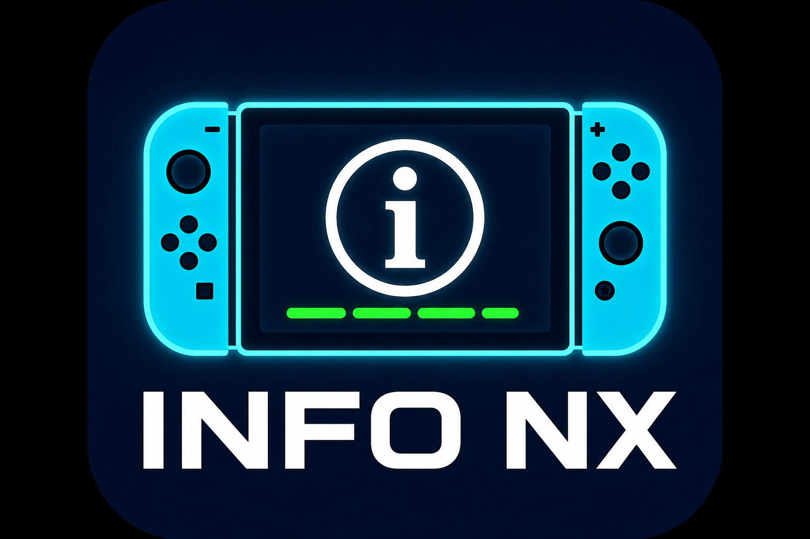

<div align="center">
  
  <h1>SwitchInfoNX</h1>
  <p><strong>Premium system information & hardware diagnostic utility for Nintendo Switch homebrew</strong></p>
  <p>
    
    
    
  </p>
  <br>
</div>

---

**Tiny description:**  
> All-in-one hardware monitor, diagnostics, system info & file transfer tool for the Nintendo Switch.

**Long description:**  
SwitchInfoNX is a feature-rich homebrew application that turns your Nintendo Switch into a diagnostics workstation. It provides a real-time overview of CPU/GPU/memory clocks, FPS, RAM & storage space, thermal readings, Joy-Con drift diagnostics, network latency, MTP & FTP transfer servers, and hardware detection (EmuMMC/SysNAND, battery health & voltages).

---

## ✨ Features (v0.5)

###  System Information & Deep Hardware
* **Firmware & Hardware**: Firmware version, serial number, hardware type (Erista V1 / Mariko V2 / Switch Lite / Switch OLED), region, system language, device nickname.
* **Environment Detection**: Real-time detection of **EmuMMC (Active)** vs **SysNAND**.
* **Battery Health Diagnostics**: Live battery percentage, charging state, **Battery Health %** estimation, raw voltage in **mV**, and real-time charge/discharge current (**mA**).
* **Thermal Monitoring**: Skin & SoC internal temperature readings, dynamic color coding (Normal / Warm / Hot), thermal threshold alerts.
* **Battery Condition**: Battery health estimate displayed with a clear condition gauge alongside charge and discharge readings.

###  Storage & File Browser
* **Storage Insights**: SD card usage, NAND partitions (USER / SYSTEM / SAFE), SD read speed test benchmark.
* **Integrated File Browser**: Full SD card file manager with unified byte calculations (B/KB/MB/GB), folder navigation, name/size sorting, copy/cut/paste, rename, and file deletion.
* **SD Space Analyzer**: Start a manual scan to see progress and a size breakdown for Nintendo, homebrew, CFW/configuration, media, and other files. Results stay cached in memory until the next scan; tap a category to sort its largest root entries and open them in the file browser. Nintendo content is reported as an aggregate, not as reliable per-game sizes.
* **File Details**: The browser shows the selected item's name, type, and file size in its footer; folders can be opened to inspect their contents.
* **Game Save Backups**: Create dated snapshots and choose a specific snapshot to restore, with a safety backup made first.

### 🌐 Network & Latency Diagnostics
* **Network Status**: IP & MAC addresses, connection type, SSID, Wi-Fi signal strength history graph with one-second samples and a 60-second timeline, plus ping history for the last 20 speed tests.
* **Speed & Latency**: Real-time latency measurement (**ping in ms** to public DNS), download/upload throughput test.
* **Live Network Traffic**: One-second receive/send rates, session totals, and a 60-second history graph from active system interfaces; these counters cover system traffic, not only SwitchInfoNX.
* **Native Ultrahand Status Overlay**: A separate Ultrahand-native `.ovl` with live SoC/PCB temperatures, battery percentage, network RX/TX rates, per-session totals, a 60-second graph, connection type, signal strength, IP address, session reset, and CSV export to SD.

###  Performance & Hardware Gauges
* **Live Clock Speeds**: Real-time CPU, GPU, and EMC memory clock frequencies.
* **Performance Graphs**: 60-second live FPS and temperature charts with rolling minimum, average, and maximum summaries, RAM usage gauge, and CPU/GPU load score.
* **Clock Scaling Controls**: Manual CPU/GPU clock target adjustment sliders.

###  Controller Diagnostics & Stick Drift Detector
* **Interactive Controller Test**: Live button state mapping, analog trigger visualization, gyroscope & accelerometer 6-axis readout.
* **Stick Drift & Deadzone Visualizer**: Circular analog stick bounds, a center reference, drift deviation percentage, and guidance to release the sticks during a drift check.

###  Transfer Protocols
* **MTP USB Transfer**: Built-in Media Transfer Protocol server over USB for high-speed drag-and-drop file transfers with PC.
* **Wi-Fi FTP Server**: Dual-mode FTP / FTPD server with compatible command handling, reliable uploads and folder creation, tuned transfer buffers, and live progress / speed feedback on the Switch.
* **Transfer Estimates**: Active transfers with a known size show an estimated time remaining based on observed progress.

### 🎨 Modern UI & Custom Themes
* **Modern Dashboard**: Sleek pill-based navigation tab bar, section-colored cards, continuous vertical scrollbars, and floating translucent toast alerts.
* **17 Built-in Presets**: Including **OLED Pure Black** (true black `#000000` power-saving mode) and **Cyberpunk Neon**, plus a full 10-slot real-time RGB custom theme editor.
* **Theme Preview**: Settings includes a live sample of the selected theme's background, card, border, and accent colors.
* **Quick Theme Palettes**: The custom editor includes Ocean, Sunset, and Forest starting palettes, with touch-friendly save/cancel buttons.
* **Stick Cursor Navigation**: Move a visible blue pointer with either analog stick and press **A** to activate controls across pages and dialogs; touch remains supported.
* **First-Run Tutorial**: A five-step introduction appears on first launch, is tracked in `tutorial.json` (`"tuto": false/true`), and can be reopened from Settings. Tutorial text and controls are localized in all 11 supported languages.
* **Ultrahand Overlay Setup Guide**: A five-step guide in Tools explains installing Ultrahand, obtaining the `.ovl`, transferring it with MTP/FTPD, and copying it to `/switch/.overlays/`.
* **Internationalization**: 11 languages supported (English, French, Italian, Spanish, German, Portuguese, Dutch, Japanese, Russian, Chinese, Korean).

---

##  Installation

1. Download the latest `SwitchInfoNX.nro` from [Releases](https://github.com/dodosiiii/SwitchInfoNX/releases)
2. Copy it to `sdmc:/switch/SwitchInfoNX/` on your Switch SD card
3. Launch via any homebrew launcher (Atmosphère, HBMenu, etc.)

### Ultrahand network overlay

1. Install [Ultrahand Overlay](https://github.com/ppkantorski/Ultrahand-Overlay) by following its installation instructions.
2. Download `SwitchInfoNX.ovl` from the SwitchInfoNX Releases page, or build it from source with `make`.
3. Copy the actual `SwitchInfoNX.ovl` file (not an archive or folder) to `sdmc:/switch/.overlays/SwitchInfoNX.ovl` using MTP or FTP.
4. Safely disconnect the SD card, then reopen Ultrahand and select the SwitchInfoNX status overlay. The Tools page's Overlay selector checks for this exact file and validates its `ULTR` signature. The overlay displays SoC and PCB temperatures, battery percentage, system interface RX/TX rates, totals since opening/reset, connection type, signal strength, IP address, and a 60-second chart. Use the export row to save `sdmc:/switch/SwitchInfoNX/network_traffic.csv`.

The `.ovl` is built against libultrahand and ends with its `ULTR` signature for native Ultrahand identification. The monitor reads kernel interface byte counters when exposed by the firmware. It first tries both BSD route-list formats and then the per-interface `SIOCGIFDATA` ioctl; the UI reports each method's errno separately. libnx exposes both `bsd:u` and `bsd:s`, but access to interface counters through the system service must be verified on-console before promising system-wide traffic data.

### Optional Atmosphere network-counter sysmodule

The overlay can query an optional SwitchInfoNX sysmodule for interface counters through a UDP request bound to loopback (`127.0.0.1`). The sysmodule uses libnx's `bsd:s` service and exposes no listener on Wi-Fi/Ethernet; it does not write polling data to the SD card. The overlay still tries the regular application-level counter methods when the sysmodule is not responding or cannot read the counters.

Build it separately with `make sysmodule`. This produces `network_sysmodule/SwitchInfoNXNetwork.nsp`. To install it, create `sdmc:/atmosphere/contents/420000000000D05A/flags/`, copy the NSP there as `exefs.nsp`, create an empty `boot2.flag` in that `flags` folder, and reboot the console. Then open the network overlay: the counter row says whether the system module or the direct path supplied the counters.

To disable it, remove `boot2.flag` and reboot. To uninstall it, remove the `420000000000D05A` contents folder after disabling it. The sysmodule has no filesystem permissions and only requests the `sm:`, `setsys`, and `bsd:s` services, but successful access to interface counters still depends on the console's Atmosphere/Horizon version and must be confirmed on-device.

---

##  Building from source

### Prerequisites

Install [devkitPro](https://devkitpro.org/) with devkitA64 and Switch portlibs. Clone with submodules so libultrahand is available:

```bash
sudo dkp-pacman -S switch-dev switch-sdl2 switch-sdl2_ttf switch-sdl2_gfx \
  switch-freetype switch-harfbuzz switch-libpng switch-bzip2 switch-glm \
  switch-curl switch-minizip
```

### Build

```bash
git clone --recurse-submodules https://github.com/dodosiiii/SwitchInfoNX.git
cd SwitchInfoNX
make
```

`make` builds `SwitchInfoNX.nro` in the project root and the native Ultrahand overlay at `overlay/SwitchInfoNX.ovl`. Copy the OVL to `sdmc:/switch/.overlays/` and install Ultrahand separately.

The optional Atmosphere network-counter sysmodule is not included in the default build. Build it explicitly with `make sysmodule`; installation and removal instructions are in the section above.

---

##  Usage

| Button | Action |
|--------|--------|
| **← →** / **Touch Tabs** | Navigate tabs (Pills navigation) |
| **↑ ↓** | Scroll within pages (System, Storage, Network, Perf, Controller, About, Tools, Settings) |
| **Y** | Force refresh / export perf metrics |
| **L / R** | Previous / next tab |
| **Left / Right Stick** | Move the blue pointer |
| **Right Stick up / down** | Scroll vertically within the current page |
| **A** | Activate the control under the pointer |
| **B** | Return / Export system report (in Tools) |
| **Touch & drag** | Smooth page scrolling, sliders adjustment (brightness, theme RGB) |

---

##  Configuration

Settings are saved to `sdmc:/switch/SwitchInfoNX/config.txt`:

* **Language** — select among 11 languages
* **Theme** — 17 built-in presets or custom RGB palette
* **Auto-refresh** — Off / 1s / 3s / 5s / 10s
* **Temperature alert** — custom threshold (default 70.0 °C)
* **Memory alert** — custom threshold (default 85 %)
* **Tools** — toggle automatic brightness using the on-screen control
* **Tutorial** — replay the introduction; completion is stored in `sdmc:/switch/SwitchInfoNX/tutorial.json`

Diagnostic reports are automatically exported to:
* `sdmc:/switch/SwitchInfoNX/system_report.txt` (Human readable report)
* `sdmc:/switch/SwitchInfoNX/sysinfo.json` (Structured JSON diagnostics)

---

##  Tech Stack

| Component | Library |
|-----------|---------|
| Graphics | SDL2 + SDL2_ttf + SDL2_gfx |
| Fonts | FreeType + HarfBuzz (Nintendo Switch shared system font) |
| Hardware APIs | libnx (`switch.h`, `setsys`, `psm`, `clkrst`, `tc`, `hid`, `nifm`) |
| Transfer Stack | Native MTP C++ implementation + FTP socket server with tuned TCP buffers |
| Toolchain | devkitA64 (`aarch64-none-elf-gcc`) |

---

## 📄 Changelog v0.5

* **Fix**: Made auto-refresh and temperature/memory alert thresholds adjustable by touch in Settings.
* **Fix**: Corrected the SD storage usage bar alignment and separated the fan and clock-scaling cards.
* **Fix**: Show a useful title ID when a game name cannot be read.
* **New**: Browse dated game-save snapshots and restore a selected snapshot; the live save is backed up first.
* **Diagnostics**: Include the libnx error code when a user profile cannot be read.
* **Fix**: Prevented save-manager arrow taps from scrolling the Tools page.
* **UI**: Smoothed and aligned FPS and skin-temperature history charts with one-second samples.
* **Fix**: Restored touch scrolling across the save-backup card; refreshed the FPS and temperature graphs with clearer scales, live markers, and 60-second timelines.
* **UI**: Enlarged the FPS history card to separate its graph, live reading, and time labels; added ascending/descending file-size sorting in the SD browser.
* **Storage**: Added a manual SD space scan with progress, category totals, in-memory result caching, and shortcuts into the file browser.
* **UI**: Added 60-second min/average/max summaries, a battery-condition gauge, selected-file details, stick center references, and a live theme preview.
* **Network / Transfer**: Signal history now uses one-second samples; known-size transfers display an estimated remaining time.
* **UI**: Added section color accents and clarified the About page's feature groups.
* **UI**: Removed screenshot capture and its controller shortcut.
* **UI**: Added a blue analog-stick pointer with A-to-activate navigation and touch-friendly file-browser confirmation controls.
* **Tools**: Added an on-screen automatic-brightness toggle and moved the auto-refresh choices to the left side of Settings.
* **Themes**: Added Ocean, Sunset, and Forest quick palettes to the custom theme editor.
* **Storage**: Prevented browser interactions from triggering page scrolling and stabilized analyzer-row taps.
* **Onboarding**: Added a five-step, 11-language first-run tutorial, a Settings shortcut to replay it, and JSON completion tracking.
* **Save Manager**: Replaced the two backup arrows with one backup selector and added localized success/failure status beside the backup action.
* **UI**: Removed the cursor hint banner and its A badge.
* **Navigation**: Added vertical page scrolling with the right stick; the left stick remains dedicated to the blue pointer.
* **Network**: Added live RX/TX rates and a 60-second traffic graph for active system interfaces.
* **Ultrahand Overlay**: Added a standalone, natively identified network monitor with live rates, session totals, 60-second history, connection details, reset, and CSV export.
* **Tools / Ultrahand**: Added a localized step-by-step installation and transfer guide for the native OVL.
* **About**: Updated the v0.5 feature list and removed implemented traffic monitoring and overlay setup from the future roadmap; sysmodule support is explicitly marked as in development.

## 📄 Changelog v0.4

* **Fix**: Unified binary/decimal byte calculation (`format_bytes`) across File Browser, FTP, and MTP.
* **Fix**: Synchronized global `APP_VERSION` definition throughout UI, FTP daemon, and export banners.
* **Fix**: Replaced primitive text arrows with modern continuous vertical scrollbars.
* **Fix**: Tab bar label clipping resolved with modern capsule "pill" navigation.
* **Fix**: Safe folder navigation and heap-allocated sort buffers in File Browser.
* **New**: Real-time **EmuMMC vs SysNAND** environment detection.
* **New**: **Battery Health %** and raw millivolt (**mV**) voltage diagnostics.
* **New**: **Stick Drift detector** & interactive deadzone visualizer on Controller page.
* **New**: Structured **JSON export** (`sysinfo.json`) alongside standard text report.
* **New**: 2 brand-new themes: **OLED Pure Black** and **Cyberpunk Neon** (18 themes total).
* **New**: Modern floating translucent toast notification badges with colored status pips.
* **New**: Public DNS network latency measurement (**ping in ms**).
* **Fix**: Improved FTP client compatibility, including explicit plain-FTP fallback when clients request unsupported TLS and idle-session cleanup.
* **Performance**: Increased FTP TCP and transfer buffers; verified a 9.4 MB upload in about 3 seconds on the tested network.
* **New**: Live FTP upload/download progress, byte count, and transfer rate on the Transfer page; percentage is shown when the client announces the file size.
* **UI**: Tightened and vertically aligned the Transfer activity log to keep its latest entries clear of the scrollbar and card edge.

---

<div align="center">
  <sub>Built with  by dodosi</sub>
  <br>
  <sub>Nintendo Switch is a trademark of Nintendo Co., Ltd. This is an unofficial homebrew project.</sub>
</div>
