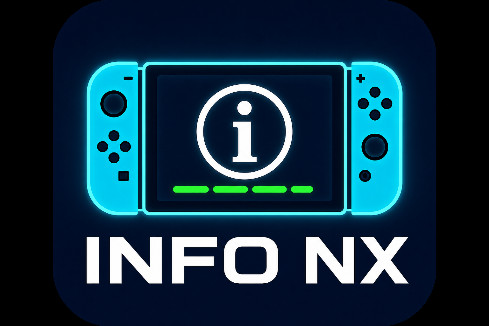

<div align="center">
  
  <h1>SwitchInfoNX</h1>
  <p><strong>All-in-one system monitor, diagnostics & file transfer tool for Nintendo Switch homebrew</strong></p>
  <p>
    
    
    
    
  </p>
</div>

---

SwitchInfoNX is a homebrew utility for the Nintendo Switch that combines hardware monitoring, system diagnostics, storage management, file transfers (HTTP / FTP / MTP), and a live Ultrahand overlay — all in one app.

---

##  Features

###  System & Power
- **Live SoC temperature** displayed in the header across all pages with dynamic color coding.
- **Hardware info**: firmware version, serial number, hardware type (Erista V1 / Mariko V2 / Lite / OLED), region, language, device nickname.
- **EmuMMC hint**: reports whether an EmuMMC configuration file or folder is present on the SD card.
- **Battery diagnostics**: percentage, charging state, health estimate, raw voltage (mV), estimated current (mA), charger type.
- **Thermal monitoring**: SoC & skin temperatures with threshold alerts.
- **Reboot to Hekate**: auto-locates Hekate payloads and triggers a warm reboot with confirmation.
- **System Restart & Power-off**: fast reboot and shutdown with zero filesystem risk.

###  Storage & File Management
- **Storage overview**: SD card and USER / SYSTEM NAND partition usage.
- **SD Speed Test**: 16 MB write / read-back throughput test (cached read-back; not a physical SD benchmark).
- **SD Space Analyzer**: manual scan with progress, category totals (Nintendo / homebrew / CFW / media / other), in-memory caching, and direct shortcuts into the file browser.
- **Integrated File Browser**: navigate SD card folders; sort by name or size; copy / cut / paste / rename / delete files and folders.
- **Fix Archive Bit**: corrects corrupt directory attributes on `/switch`, `/atmosphere`, and `/bootloader` caused by Windows / macOS transfers.
- **Mac Junk Cleaner**: recursively deletes `._*` and `.DS_Store` metadata files.
- **Crash Dump Purge**: scans and deletes Atmosphère `/crash_reports`, `/fatal_reports`, and `/erpt_reports` with reclaimed-space reporting.
- **Game Save Backups**: create dated snapshots and restore a selected one (live save backed up first).

###  Network & Diagnostics
- **Network status**: IP & MAC addresses, connection type, SSID, Wi-Fi signal strength, last 20 TCP connection-time results.
- **Speed & Latency**: download / upload throughput tests and TCP connection time against Nintendo's test endpoint on port 80.
- **Live traffic**: 1-second RX / TX rates, session totals, and a 60-second history graph from active system interfaces.
- **CFW Anti-Ban & Telemetry Shield**: live async DNS.mitm / 90DNS tests against Nintendo telemetry endpoints (`ctest`, `dauth-lp1`, `receive-lp1`).

###  Ultrahand Overlay
A native Ultrahand `.ovl` with:
- Live CPU / GPU / EMC clock speeds (MHz)
- Operation mode (Docked / Handheld)
- Battery % and health estimate
- Charger type and SD free / total space
- Brightness display + **[A]** to cycle Low → Medium → High → Max
- RX / TX rates, session totals, 60-second traffic graph, connection type, signal strength, IP address
- Session reset and CSV export to `sdmc:/switch/SwitchInfoNX/network_traffic.csv`
- **Power & Quick Actions**: Reboot to Hekate / payload, Reboot Console, Power Off Console

### Performance & Hardware
- **Live clocks**: real-time CPU, GPU, and EMC frequencies.
- **Performance graphs**: app loop rate and temperature samples with rolling min / average / max summaries.
- **Clock scaling**: touch-adjustable CPU / GPU sliders rounded to supported clock rates.
- **Installed titles**: browse up to 64 installed application titles.
- **Performance export**: press **Y** on the Perf page to append a snapshot to `sdmc:/switch/SwitchInfoNX/perf_metrics_v06.csv`.
- **Fan control feedback**: shows the controller-reported fan level with a note that thermal protections may override it.

###  Controller Diagnostics
- **Interactive controller test**: live button state mapping, analog trigger visualization, 6-axis gyroscope & accelerometer readout.
- **Stick position display**: live coordinates and center reference (not a drift diagnosis or calibrated deadzone test).
- **Joy-Con colors**: rendered from internal SPI flash with `#RRGGBB` hex badges.
- **HD Rumble Suite**: touch / button triggers for Left, Dual, and Right motors with active wave animation.
- **Stick Drift & Deadzone Analyzer**: real-time deviation %, neutral point precision, peak rest jitter, and Reset Peak button.

###  File Transfers
- **HTTP Browser Transfer**: start the built-in HTTP server, scan the QR code with your phone, and transfer files without typing an IP address. Supports browsing, downloading, uploading (with directory structure), folder creation, and deletion. Each session generates a temporary 8-digit access code (username `switch`).
- **Wi-Fi FTP Server**: dual-mode FTP / FTPD server with live progress, speed, and ETA feedback on the Switch screen.
- **USB MTP Transfer**: built-in MTP server for drag-and-drop transfers with PC at USB speeds.
- **Transfer log**: unified chronological activity log for FTP / MTP / HTTP events.

> **Security note**: HTTP is unencrypted and intended for a trusted local network only. Do not expose port 8080 to the Internet.

###  UI & Themes
- **Modern dashboard**: pill-based tab bar, section-colored cards, continuous vertical scrollbars, translucent toast alerts.
- **17 built-in themes**: including **OLED Pure Black** (true `#000000`) and **Cyberpunk Neon**.
- **Custom theme editor**: 10-slot real-time RGB editor with Ocean / Sunset / Forest quick palettes and live preview.
- **Analog-stick cursor**: blue pointer navigable with either stick; press **A** to activate controls.
- **First-run tutorial**: 5-step introduction in all 11 languages, replayable from Settings.
- **11 languages**: English, French, Italian, Spanish, German, Portuguese, Dutch, Japanese, Russian, Chinese, Korean.

---

##  Installation

### Main app

1. Download `SwitchInfoNX.nro` from [Releases](https://github.com/dodosiiii/SwitchInfoNX/releases).
2. Copy it to `sdmc:/switch/SwitchInfoNX/SwitchInfoNX.nro`.
3. Launch from any homebrew launcher (Atmosphère HBMenu, etc.).

### Ultrahand Overlay

1. Install [Ultrahand Overlay](https://github.com/ppkantorski/Ultrahand-Overlay).
2. Download `SwitchInfoNX.ovl` from the Releases page (or build from source with `make`).
3. Copy it to `sdmc:/switch/.overlays/SwitchInfoNX.ovl` via MTP or FTP.
4. Open Ultrahand and select SwitchInfoNX from the overlay list.

### Optional sysmodule (network counters)

The overlay can query an optional sysmodule for interface counters over a loopback UDP request. Build with `make sysmodule` to produce `network_sysmodule/SwitchInfoNXNetwork.nsp`.

**Install:**
```
sdmc:/atmosphere/contents/420000000000D05A/exefs.nsp
sdmc:/atmosphere/contents/420000000000D05A/flags/boot2.flag  (empty file)
```
Reboot. **Disable:** remove `boot2.flag` and reboot. **Uninstall:** remove the whole `420000000000D05A` folder after disabling.

---

##  Building from source

### Prerequisites

Install [devkitPro](https://devkitpro.org/) with devkitA64 and Switch portlibs:

```bash
sudo dkp-pacman -S switch-dev switch-sdl2 switch-sdl2_ttf switch-sdl2_gfx \
  switch-freetype switch-harfbuzz switch-libpng switch-bzip2 switch-glm \
  switch-curl switch-minizip
```

### Build

```bash
git clone --recurse-submodules https://github.com/dodosiiii/SwitchInfoNX.git
cd SwitchInfoNX
make
```

`make` produces `SwitchInfoNX.nro` and `overlay/SwitchInfoNX.ovl`.  
Build the sysmodule separately: `make sysmodule`.

---

##  Controls

| Button | Action |
|--------|--------|
| **← → / Touch tabs** | Switch pages |
| **L / R** | Previous / next tab |
| **↑ ↓** | Scroll within a page |
| **Left stick** | Move the blue cursor |
| **Right stick ↑↓** | Scroll the current page |
| **A** | Activate the control under the cursor |
| **B** | Back / export system report (Tools) |
| **Y** | Force refresh / export perf metrics (Perf) |
| **Touch & drag** | Smooth scrolling, slider adjustment |

---

##  Configuration

Settings are saved to `sdmc:/switch/SwitchInfoNX/config.txt`:

| Setting | Options |
|---------|---------|
| Language | 11 languages |
| Theme | 17 presets or custom RGB |
| Auto-refresh | Off / 1 s / 3 s / 5 s / 10 s |
| Temperature alert | Custom threshold (default 70 °C) |
| Memory alert | Custom threshold (default 85 %) |
| Auto-brightness | Toggle from Settings / Tools |
| Tutorial | Replay from Settings |

Diagnostic exports:
- `sdmc:/switch/SwitchInfoNX/system_report.txt` — human-readable report
- `sdmc:/switch/SwitchInfoNX/sysinfo.json` — structured JSON

---

##  Tech Stack

| Component | Library / Tool |
|-----------|---------------|
| Graphics | SDL2 · SDL2_ttf · SDL2_gfx |
| Fonts | FreeType · HarfBuzz (Switch shared system font) |
| Hardware APIs | libnx (`setsys`, `psm`, `clkrst`, `tc`, `hid`, `nifm`, `lbl`, `spsm`, `bpc`) |
| Overlay framework | libultrahand (Tesla) |
| Transfer stack | Native MTP · FTP socket server · Authenticated HTTP server |
| Toolchain | devkitA64 (`aarch64-none-elf-gcc`) |

---

##  Changelog

See [CHANGELOG.md](CHANGELOG.md) for the full version history.

---

<div align="center">
  <sub>Built with ❤️ by dodosi</sub><br>
  <sub>Nintendo Switch is a trademark of Nintendo Co., Ltd. — SwitchInfoNX is an unofficial homebrew project.</sub>
</div>
